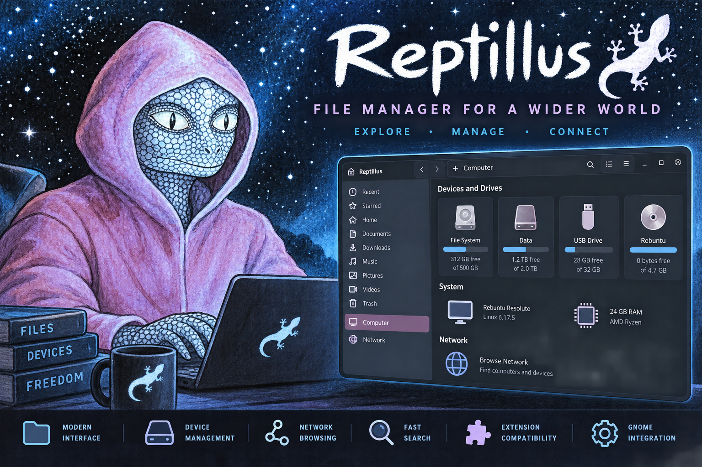

Reptillus is a graphical file manager for Rebuntu, based on GNOME Files (Nautilus). It is an independent fork; upstream GNOME CI badges do not represent Reptillus build or test status.

## Project origin

Reptillus is an independent fork of [GNOME Files (Nautilus)](https://apps.gnome.org/Nautilus/). GNOME's upstream builds, issue tracker, and CI results do not describe or validate Reptillus. For Reptillus-specific changes and issues, see the [Reptillus repository](https://github.com/bvrznski/reptillus).

## Runtime dependencies
- [Bubblewrap](https://github.com/containers/bubblewrap) installed. Used for security reasons.
- [LocalSearch](https://gitlab.gnome.org/GNOME/localsearch) properly set up and with all features enabled. Used for fast search and metadata extraction, starred files and batch renaming.
- [xdg-user-dirs-gtk](https://gitlab.gnome.org/GNOME/xdg-user-dirs-gtk) installed.  Used to create the default bookmarks and update localization.

## Community and support

For Reptillus discussions and support, use the [Reptillus GitHub repository](https://github.com/bvrznski/reptillus). GNOME Nautilus community channels are for the upstream project.

## Extensions

Reptillus maintains a separately named extension API (`libreptillus-extension`). Upstream Nautilus extension documentation may be useful as background, but compatibility must be verified against Reptillus.

## How to report issues

Report Reptillus issues at [Reptillus GitHub Issues](https://github.com/bvrznski/reptillus/issues). Include the operating system, Reptillus version, steps to reproduce, and relevant logs.

## Feature requests

Propose Reptillus features through [Reptillus GitHub Issues](https://github.com/bvrznski/reptillus/issues). GNOME design approval requirements apply to upstream Nautilus, not automatically to this fork.

